# Target Fixes and Features — Architectural Plan & Blast Radius

This document specifies the architectural plan, root-cause diagnosis, forensic analysis of LM Studio execution logs, blast radius analysis, and step-by-step roadmap for resolving CLI issues, model accuracy, `mcp-compressor` subprocess execution, TUI key interception, and offline MCP tool schema bundling in `can-i-compress-it`.

---

## 1. Executive Summary & Root Cause Analysis

### 1.1 Documentation & License Alignment
* **Issue**: [README.md](file:///Users/dev-isolated/Desktop/Projects/compression-quality-checker/README.md#L4) displays an Apache 2.0 license shield badge (`[](LICENSE)`), whereas the repository's [LICENSE](file:///Users/dev-isolated/Desktop/Projects/compression-quality-checker/LICENSE#L1) is the standard MIT License.
* **Root Cause**: Stale shield URL badge in the top-level README.
* **Resolution**: Update the badge in [README.md](file:///Users/dev-isolated/Desktop/Projects/compression-quality-checker/README.md) to reflect MIT (`License-MIT-blue.svg`).

---

### 1.2 TUI Key Interception ('a' Key Locked, Numeric Keys, Spaces)
* **Issue**: When attempting to enter a custom binary path (such as `~/.cargo/bin/mcp-compressor`) or file paths in the TUI, typing the letter `'a'` or `'A'` fails to input the character. Instead, it selects all compression levels. Similarly, pressing numeric keys (`1`–`5`) or the spacebar inside input boxes triggers tab switches or checkbox toggles.
* **Root Cause**:
  1. In [internal/tui/step_compression.go](file:///Users/dev-isolated/Desktop/Projects/compression-quality-checker/internal/tui/step_compression.go#L131-L135), the key handler intercepts `"a"` and `"A"` globally before checking the focused component:
     ```go
     case "a", "A":
         for i := range m.levels {
             m.levels[i].Selected = true
         }
         return m, nil
     ```
     This prevents `m.compressorBin.Update(msg)` from receiving the letter `'a'`.
  2. In [internal/tui/step_suite.go](file:///Users/dev-isolated/Desktop/Projects/compression-quality-checker/internal/tui/step_suite.go#L112-L128), keys `"1"` through `"5"` switch tabs unconditionally even when typing numeric values (like task counts or random seeds) into text input fields.
  3. Paths containing tildes (e.g. `~/.cargo/bin/mcp-compressor`) are not expanded to the user's home directory.
* **Resolution**:
  1. Scope shortcut key handlers (`a`/`A`, `1`–`5`, `space`) in [step_compression.go](file:///Users/dev-isolated/Desktop/Projects/compression-quality-checker/internal/tui/step_compression.go) and [step_suite.go](file:///Users/dev-isolated/Desktop/Projects/compression-quality-checker/internal/tui/step_suite.go) so they only trigger when a text input is not focused (`focusLevels` or `focusBackend`).
  2. Expand `~` to `os.UserHomeDir()` in `CompressorBinary()`.

---

### 1.3 `mcp-compressor` Subprocess Invocation & Protocol Handling
* **Issue**: `mcp-compressor` fails to run or execute when configured as the compression backend.
* **Root Cause**:
  1. **Flag syntax mismatch**: [internal/mcp/subprocess.go](file:///Users/dev-isolated/Desktop/Projects/compression-quality-checker/internal/mcp/subprocess.go#L46-L49) passes `--level <level>`. The actual `mcp-compressor` CLI uses `-c, --compression <low|medium|high|max>`.
  2. **Level `none` handling**: `mcp-compressor` only accepts `low`, `medium`, `high`, and `max`. Level `none` represents the uncompressed baseline.
  3. **Missing target server command**: `mcp-compressor` is a proxy and requires `-- <URL_OR_COMMAND> [ARGS...]` specifying the downstream MCP server. When executing benchmark task suites, `TargetCmd` was empty in [internal/cmd/run.go](file:///Users/dev-isolated/Desktop/Projects/compression-quality-checker/internal/cmd/run.go) and [internal/tui/view_running.go](file:///Users/dev-isolated/Desktop/Projects/compression-quality-checker/internal/tui/view_running.go), causing `mcp-compressor` to terminate immediately due to missing arguments.
* **Resolution**:
  1. Update flag generation in [internal/mcp/subprocess.go](file:///Users/dev-isolated/Desktop/Projects/compression-quality-checker/internal/mcp/subprocess.go) to `-c <level>`.
  2. If level is `none`, bypass `mcp-compressor` and execute the target command directly (or return uncompressed tool definitions).
  3. Implement a lightweight built-in stdio MCP server subcommand (`can-i-compress-it serve-mcp`) so that `mcp-compressor` can wrap the harness executable itself (`mcp-compressor -c <level> -- <exe> serve-mcp --suite <suite>`) when benchmarking task suites offline.

---

### 1.4 Forensic Analysis of LM Studio Logs (`lm_studio_logs.txt`)
A forensic analysis of the 31,582 log lines from previous test sessions reveals the exact chain of failure:
1. **Chat Template Dropped Tools**: In requests containing full JSON `tools: [...]` arrays (~1,000–2,000 schema tokens), LM Studio evaluated **only 32 to 63 prompt tokens** (e.g. `prompt eval time = 13.13 ms / 32 tokens`, `prompt_tokens: 61`). LM Studio's default Jinja template for `phi-3.5-mini-instruct` silently stripped the `tools` array from the prompt context.
2. **Model Responded That No Tools Existed**: Receiving only `"Call update_issue_status..."` without schemas in context, the model explicitly apologized:
   * *"since there's no specific programming language context here and tools are not available to execute actual functions: ```python update_issue_status(...) ```"*
   * *"As an AI language model, I don't have the ability to directly execute database queries or call functions..."*
   * *"If the add_comment functionality does not exist and I am unable to invoke tools without proper context..."*
3. **Model Emitted Code / Pseudocode Snippets**: The model attempted to satisfy the prompt by emitting Python and Bash blocks (e.g. ````python update_issue_status(issue_key='ACME-77', new_status='In Review') ````), which returned `"tool_calls": []` from LM Studio and were not parsed by standard JSON matchers.

---

### 1.5 Scientific Integrity of System Prompt Tool Formatting
When addressing model tool awareness, a critical question arises: **Does injecting tools into the system prompt undermine or invalidate the compression quality benchmark?**

* **The Risk (Why Static Uncompressed Injection Would Invalidate the Suite)**:
  If the harness were to inject static, uncompressed tool schemas into the system prompt across all compression levels, the test would be completely ruined. At `high` compression (where descriptions are stripped to test if a model can bind parameters by name alone), the model would "cheat" by reading the uncompressed descriptions from the system prompt.
* **The Solution (Faithful Level-Specific Compressed Rendering)**:
  In real-world inference, all models (Claude, GPT-4, Qwen, Llama) receive tools as formatted text in their context window. When the API payload is ignored by local server templates, the harness must format the **exact compressed tools of the active level** into the prompt context:
  * **Level None**: Full schema formatted in prompt (~1,500 tokens).
  * **Level Low**: Truncated descriptions in prompt (~800 tokens).
  * **Level Medium**: 60-character descriptions, no optional parameters (~400 tokens).
  * **Level High**: Bare parameter names and types with zero descriptions (~150 tokens).
  * **Level Max**: Only the 2 meta-tools (`get_tool_schema` and `invoke_tool`) + the bare list of tool names (`Available tools: get_issue, list_issues, update_issue_status`) (~80 tokens).
* **Guaranteed Properties**:
  1. **Authentic Information Degradation**: At `high`, descriptions remain completely absent; at `medium`, optional parameters remain absent; at `max`, the model must perform the two-step lookup.
  2. **Authentic Token Ratios**: Token consumption reflects the 70%–95% compression curve.
  3. **Universal Compatibility**: Local models without native function-calling templates participate reliably in the benchmark.

---

### 1.6 Offline Popular Tool Schemas & Bundled Suites (No Real Server Needed)
* **Issue**: Benchmarking MCP tool suites should not require setting up and running live MCP servers (e.g. configuring `npx @modelcontextprotocol/server-github` with personal access tokens).
* **Root Cause**: Only 5 hardcoded templates existed in code, and benchmarking custom servers required live stdio processes.
* **Resolution**:
  1. Add a `suites/schemas/` directory containing static JSON schema fixtures for popular MCP servers:
     - `github.json`, `jira.json`, `slack.json`, `sqlite.json`, `filesystem.json`, `postgres.json`, `memory.json`, `fetch.json`, `brave-search.json`, `puppeteer.json`, `git.json`.
  2. Implement `scripts/fetch_mcp_schemas.py` (`uv run scripts/fetch_mcp_schemas.py`) to fetch/refresh schemas from registries or npm packages.
  3. Embed `suites/schemas/*.json` into the Go binary (`//go:embed`) in [internal/suite/](file:///Users/dev-isolated/Desktop/Projects/compression-quality-checker/internal/suite/) to generate benchmark suites offline without configuring live servers.
  4. Expose all bundled popular tool suites in the TUI (Step 2: Pre-annotated Templates) and CLI (`suite import --schema <file>` / `run --suite-schema <file>`).

---

## 2. Blast Radius Assessment

```mermaid
graph TD
    A["License Badge Fix"] --> B["README.md"]
    C["TUI Input Scoping"] --> D["internal/tui/step_compression.go"]
    C --> E["internal/tui/step_suite.go"]
    F["mcp-compressor Invocation"] --> G["internal/mcp/subprocess.go"]
    F --> H["internal/cmd/serve_mcp.go (New)"]
    I["Prompt & Scoring Engine"] --> J["internal/runner/scheduler.go"]
    I --> K["internal/inference/client.go"]
    I --> L["internal/eval/matcher.go"]
    M["Offline Schema Bundling"] --> N["suites/schemas/*.json (New)"]
    M --> O["scripts/fetch_mcp_schemas.py (New)"]
    M --> P["internal/suite/templates.go & load.go"]
```



| Component | Files Modified / Created | Risk Level | Blast Radius Mitigation |
|---|---|---|---|
| **Docs** | [README.md](file:///Users/dev-isolated/Desktop/Projects/compression-quality-checker/README.md) | None | Purely visual markdown change |
| **TUI Key Routing** | [internal/tui/step_compression.go](file:///Users/dev-isolated/Desktop/Projects/compression-quality-checker/internal/tui/step_compression.go), [internal/tui/step_suite.go](file:///Users/dev-isolated/Desktop/Projects/compression-quality-checker/internal/tui/step_suite.go), [internal/tui/tui_test.go](file:///Users/dev-isolated/Desktop/Projects/compression-quality-checker/internal/tui/tui_test.go) | Low | Isolated to Bubble Tea `Update` message dispatch; covered by unit tests |
| **MCP Subprocess & Proxy** | [internal/mcp/subprocess.go](file:///Users/dev-isolated/Desktop/Projects/compression-quality-checker/internal/mcp/subprocess.go), [internal/mcp/proxy.go](file:///Users/dev-isolated/Desktop/Projects/compression-quality-checker/internal/mcp/proxy.go), `internal/cmd/serve_mcp.go` | Low-Med | Standardizes JSON-RPC 2.0 stdio flags and provides built-in suite backend fallback |
| **Runner & Inference** | [internal/runner/scheduler.go](file:///Users/dev-isolated/Desktop/Projects/compression-quality-checker/internal/runner/scheduler.go), [internal/inference/client.go](file:///Users/dev-isolated/Desktop/Projects/compression-quality-checker/internal/inference/client.go), [internal/eval/matcher.go](file:///Users/dev-isolated/Desktop/Projects/compression-quality-checker/internal/eval/matcher.go) | Low-Med | Backward-compatible: mock model and OpenAI endpoints pass all existing unit tests |
| **Suites & Schemas** | `suites/schemas/*.json`, `scripts/fetch_mcp_schemas.py`, [internal/suite/templates.go](file:///Users/dev-isolated/Desktop/Projects/compression-quality-checker/internal/suite/templates.go), [internal/suite/load.go](file:///Users/dev-isolated/Desktop/Projects/compression-quality-checker/internal/suite/load.go) | Low | Extends template registry via embedded static schemas without altering existing suite JSON structure |

---

## 3. Step-by-Step Implementation Roadmap

1. **Step 1 — License & Docs**: Correct [README.md](file:///Users/dev-isolated/Desktop/Projects/compression-quality-checker/README.md) badge to MIT.
2. **Step 2 — TUI Key Navigation**: Fix text input focus guards in [step_compression.go](file:///Users/dev-isolated/Desktop/Projects/compression-quality-checker/internal/tui/step_compression.go) and [step_suite.go](file:///Users/dev-isolated/Desktop/Projects/compression-quality-checker/internal/tui/step_suite.go). Add tilde path expansion.
3. **Step 3 — MCP Subprocess & `serve-mcp`**:
   - Implement `serve-mcp` command in `internal/cmd/serve_mcp.go`.
   - Update [subprocessProxy](file:///Users/dev-isolated/Desktop/Projects/compression-quality-checker/internal/mcp/subprocess.go) with `-c <level>` flags, level `none` passthrough, and suite stdio backend support.
4. **Step 4 — System Prompt, Tool Awareness & Scoring**:
   - Update [systemPrompt](file:///Users/dev-isolated/Desktop/Projects/compression-quality-checker/internal/runner/scheduler.go) to format the active compression level's schema directly into context with standard JSON invocation format instructions.
   - For `LevelMax`, provide the list of available tool names so the model can query `get_tool_schema` and execute `invoke_tool`.
   - Add `"tool_choice": "auto"` and expand [extractTextToolCalls](file:///Users/dev-isolated/Desktop/Projects/compression-quality-checker/internal/inference/client.go) to recognize pseudocode / Python call patterns.
   - Normalize string-to-number comparison in [matcher.go](file:///Users/dev-isolated/Desktop/Projects/compression-quality-checker/internal/eval/matcher.go).
5. **Step 5 — Offline Popular Tool Schemas**:
   - Add static schema fixtures in `suites/schemas/` for GitHub, Jira, Slack, SQLite, Filesystem, Postgres, Memory, Fetch, Brave Search, Puppeteer, Git.
   - Add `scripts/fetch_mcp_schemas.py`.
   - Integrate schema loader into [internal/suite/](file:///Users/dev-isolated/Desktop/Projects/compression-quality-checker/internal/suite/) and TUI Step 2.
6. **Step 6 — Verification**: Run `go test ./...`, format with `gofumpt`, and run end-to-end matrix sweep verification.
